  

  
  
  

---

## About

<table>
  <tr><td><b>Studying</b></td><td>Master of Applied Computing, University of Windsor</td></tr>
  <tr><td><b>Background</b></td><td>B.Tech in Computer Science and Engineering, Charotar University of Science and Technology</td></tr>
  <tr><td><b>Based in</b></td><td>Windsor, ON, Canada</td></tr>
  <tr><td><b>Languages</b></td><td>English, Hindi, Gujarati, Sanskrit</td></tr>
  <tr><td><b>Looking for</b></td><td>A 4–8 month co-op starting January 2027</td></tr>
</table>

I like projects where data, models and software have to work together: a classifier is only useful once it sits inside something people can run. Most of my work so far is coursework and personal builds, listed below.

---

## Projects

<table>
  <tr>
    <td width="50%" valign="top">
      <b><a href="https://github.com/bhavyapatel0201/f1-race-dashboard">F1 Race Data Dashboard and Winner Predictor</a></b> 
      Data science
      
Streamlit dashboard on real Formula 1 data, plus a race-winner model with leak-free features, walk-forward validation and a held-out test season.

      Python · Streamlit · Plotly · pandas
    </td>
    <td width="50%" valign="top">
      <b><a href="https://github.com/bhavyapatel0201/retail-analytics-platform">Retail Analytics Platform</a></b> 
      Data engineering
      
dbt and DuckDB pipeline on the Olist e-commerce dataset: raw loader and tested staging layer done, marts in progress.

      dbt · DuckDB · SQL · Python
    </td>
  </tr>
  <tr>
    <td width="50%" valign="top">
      <b><a href="https://github.com/bhavyapatel0201/ketana-drishti">Ketana Drishti</a></b> 
      Applied AI
      
Vedic astrology that computes first and interprets second: an ephemeris engine builds the chart, and an LLM only explains the facts it is given.

      Python · LLM
    </td>
    <td width="50%" valign="top">
      <b><a href="https://github.com/bhavyapatel0201/kitsune-nids">Kitsune NIDS</a></b> 
      Team project, machine learning
      
Online network intrusion detector using damped per-host statistics and an autoencoder ensemble. I built the lab: VM setup, benign traffic and attack scripts.

      Python · autoencoders · pytest
    </td>
  </tr>
  <tr>
    <td width="50%" valign="top">
      <b><a href="https://github.com/bhavyapatel0201/Adaptive-Warehouse">Adaptive Sales Data Warehouse</a></b> 
      Data engineering
      
Tests whether workload-aware index and partition tuning beats a static design as query patterns shift.

      PostgreSQL · Python
    </td>
    <td width="50%" valign="top">
      <b><a href="https://github.com/bhavyapatel0201/ResumeExtractor">Resume Extractor</a></b> 
      Automation
      
Resume upload web app that sends resumes to an n8n workflow for extraction, with a Python backend for Word-template output.

      Python · JavaScript · n8n
    </td>
  </tr>
</table>

More on my [repositories page](https://github.com/bhavyapatel0201?tab=repositories).

---

## Toolbox

<table align="center">
  <tr><td align="center" width="150"><b>Languages</b></td><td> </td></tr>
  <tr><td align="center" width="150"><b>Data and analysis</b></td><td>    </td></tr>
  <tr><td align="center" width="150"><b>ML and vision</b></td><td> </td></tr>
  <tr><td align="center" width="150"><b>Web and backend</b></td><td>  </td></tr>
  <tr><td align="center" width="150"><b>Automation</b></td><td> </td></tr>
  <tr><td align="center" width="150"><b>Workflow and deploy</b></td><td> </td></tr>
</table>

---

## Activity

  

  

  

  

---

## GET IN TOUCH

Working on something in AI/ML or data engineering? Reach out through any of the links at the top.
