<!-- cards:start -->

<!-- cards:end -->

Contact: <a href="mailto:patel61d@uwindsor.ca">patel61d@uwindsor.ca</a> · Cards are rendered by <a href="scripts/build_cards.py">scripts/build_cards.py</a> and refreshed daily.

