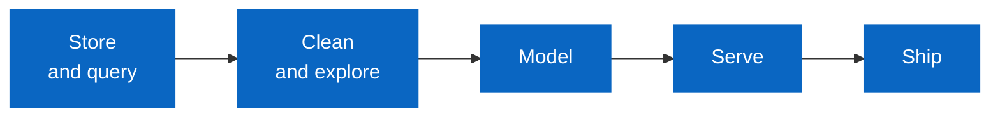

  

  

  
  
  

  <a href="#about">About</a> &nbsp;·&nbsp;
  <a href="#focus">Focus</a> &nbsp;·&nbsp;
  <a href="#projects">Projects</a> &nbsp;·&nbsp;
  <a href="#skills">Skills</a> &nbsp;·&nbsp;
  <a href="#contact">Contact</a>

  
  

---

## 👋 About me

I'm a Master of Applied Computing student at the **University of Windsor**. I build applied AI and data-driven systems, from cleaning data and training models to putting them behind an interface.

| | |
|---|---|
| 📍 **Based in** | Windsor, ON, Canada |
| 🎓 **Currently pursuing** | Master of Applied Computing at the **University of Windsor** |
| 🎯 **Looking for** | Co-op / internship roles starting **January 2027** in AI/ML and data engineering |
| 💬 **Ask me about** | NLP document automation, time-series forecasting (SARIMAX), computer vision, data warehousing |
| 🗣️ **Languages** | English, Hindi, Gujarati, Sanskrit |

---

## 🎯 What I work on

<table>
  <tr>
    <td align="center" width="33%">
      <h3>🤖</h3>
      <b>AI / ML</b> 
      CNNs, transfer learning, NLP, time-series forecasting
    </td>
    <td align="center" width="33%">
      <h3>🗄️</h3>
      <b>Data engineering</b> 
      ETL, data warehousing, query optimization
    </td>
    <td align="center" width="33%">
      <h3>⚙️</h3>
      <b>Systems</b> 
      Unix programming, backend services, Docker
    </td>
  </tr>
</table>

---

## 🚀 Projects

| Project | What it does | Stack |
|---|---|---|
| 🛡️ [**Credit Card Fraud Detection**](https://github.com/bhavyapatel0201/Credit-Card-Fraud-Detection) | Classifies fraudulent transactions on highly imbalanced data | Python, scikit-learn, Jupyter |
| 🏗️ [**Adaptive Sales Data Warehouse**](https://github.com/bhavyapatel0201/Adaptive-Warehouse) | Tests whether workload-aware index and partition tuning beats a static design as query patterns shift | PostgreSQL, Python |
| 📄 [**Resume Extractor**](https://github.com/bhavyapatel0201/ResumeExtractor) | NLP pipeline that pulls skills, education and experience out of resumes | Python, NLP |
| 🖼️ [**Transfer Learning Object Classification**](https://github.com/bhavyapatel0201/Transfer-Learning-Object-Classification) | Image classification with pretrained CNNs | Python, deep learning |
| 📷 [**Stereo Matching & Epipolar Geometry**](https://github.com/bhavyapatel0201/Stereo-Image-Matching-And-Epipolar-Geometry) | Camera calibration, epipolar geometry and stereo reconstruction | Python, OpenCV |

<b>More things I've built</b> (click to expand)

 

- 🌿 **Plant disease detection:** CNN classifier for plant leaf images, reaching 96%+ accuracy
- 📈 **Time-series forecasting:** SARIMAX model that handles seasonality and external variables
- 🔌 **Backend services:** REST APIs built with Node.js

---

## 🛠️ Skills

How I work: from raw data to something people can use.

| Stage | Tools |
|:---|:---|
| **Foundation** |  |
| **1. Store and query** |     Seen in: <a href="https://github.com/bhavyapatel0201/Adaptive-Warehouse">Adaptive-Warehouse</a> |
| **2. Clean and explore** |    Seen in: <a href="https://github.com/bhavyapatel0201/Credit-Card-Fraud-Detection">Credit-Card-Fraud-Detection</a>, <a href="https://github.com/bhavyapatel0201/Credit-Card-Comparison-Analysis">Credit-Card-Comparison-Analysis</a> |
| **3. Model** |      Seen in: <a href="https://github.com/bhavyapatel0201/Transfer-Learning-Object-Classification">Transfer-Learning-Object-Classification</a>, <a href="https://github.com/bhavyapatel0201/ResumeExtractor">ResumeExtractor</a>, <a href="https://github.com/bhavyapatel0201/Stereo-Image-Matching-And-Epipolar-Geometry">Stereo-Image-Matching</a> |
| **4. Serve** |    Seen in: <a href="https://github.com/bhavyapatel0201/Adaptive-Warehouse">Adaptive-Warehouse (web UI)</a>, <a href="https://github.com/Rajbeer-117/StudySync">StudySync (Django, group project)</a>, <a href="https://bhavyapatel0201.github.io">this portfolio</a> |
| **5. Ship** |   Seen in: <a href="https://github.com/bhavyapatel0201/Adaptive-Warehouse">Adaptive-Warehouse (Docker and Render config)</a> |

---

## 📫 Let's connect

I'm looking for a co-op or internship starting **January 2027**. The best way to reach me is through LinkedIn or my portfolio.

  
  

  

